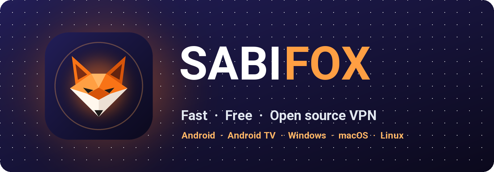
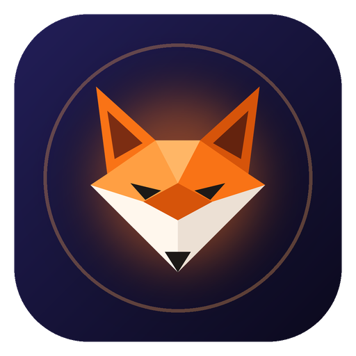

<div align="center" dir="ltr">

[🇺🇸 English](../../README.md) &nbsp;/&nbsp; **🇮🇷 فارسی** &nbsp;/&nbsp; [🇨🇳 简体中文](README_zh.md) &nbsp;/&nbsp; [🇷🇺 Русский](README_ru.md)

</div>
<br>

<p align="center"></p>

<h2 align="center" dir="rtl">⚠️ پروژه غیررسمی</h2>

<h3 align="center" dir="rtl">&rlm;SABIFOX یک پروژه مستقل است. موزیلا آن را نساخته، مالک آن نیست، از آن حمایت نمی‌کند، آن را تأیید نکرده و هیچ ارتباطی با آن ندارد. <a href="#سلب-مسئولیت">سلب مسئولیت</a> را ببینید.</h3>

<div align="center">

[](https://github.com/sabi-karami/sabifox/releases)
[](https://github.com/sabi-karami/sabifox/releases/latest)
[](../../LICENSE)
[](https://github.com/sabi-karami/sabifox/stargazers)
[](https://github.com/sabi-karami/sabifox/actions)


</div>

<div dir="rtl">

## &rlm;SABIFOX چیست؟

&rlm;**SABIFOX** یک VPN رایگان و متن‌باز است که با حساب فایرفاکس (Firefox Account) کار می‌کند. اینترنت شما را از سرورهای موزیلا، روی زیرساخت **Fastly**، و با تونل‌های امن **HTTP/2 و HTTP/3** عبور می‌دهد.

&rlm;برای **اندروید، ویندوز، مک و لینوکس**؛ کاملاً رایگان، بدون تبلیغات.


## 🚀 امکانات اصلی

✈️ چندپلتفرمی: اندروید، ویندوز، مک و لینوکس

📺 اندروید TV: قابل استفاده با کنترل تلویزیون

⭐ استفاده بسیار آسان با رابط کاربری ساده

&rlm;🆓 رایگان: هر حساب فایرفاکس ماهی ۵۰ گیگابایت

🌐 سرورهای موزیلا: انتخاب کشور با تست پینگ، یا انتخاب خودکار بهترین سرور

⚡ اتصال سریع و پایدار با HTTP/2 و HTTP/3

🔀 مسیریابی هوشمند (Split Tunneling): سایت‌ها و برنامه‌هایی که از VPN عبور نکنند را انتخاب کنید

🧱 اگر شبکه شما اتصال را مسدود کند: فرگمنت TLS، پروکسی SOCKS5 بالادستی و سرور رله

&rlm;🔒 DNS رمزگذاری‌شده (DNS over HTTPS)

🌍 ۱۵ زبان، از جمله انگلیسی، فارسی، چینی و روسی

🌙 پوسته روشن و تیره

🛡 اپن سورس، کاملا امن و کامیونیتی محور

🔄 آپدیت خودکار


## 📥 دانلود مستقیم

<table>
<thead align="right">
<tr><th>سیستم‌عامل</th><th>دانلود</th></tr>
</thead>
<tbody align="right">
<tr><td>اندروید</td><td><a href="https://github.com/sabi-karami/sabifox/releases/latest/download/SABIFOX-Android-universal.apk"></a><br><a href="https://github.com/sabi-karami/sabifox/releases/latest/download/SABIFOX-Android-arm64-v8a.apk"></a><br><a href="https://github.com/sabi-karami/sabifox/releases/latest/download/SABIFOX-Android-armeabi-v7a.apk"></a><br><a href="https://github.com/sabi-karami/sabifox/releases/latest/download/SABIFOX-Android-x86_64.apk"></a></td></tr>
<tr><td>اندروید TV</td><td><a href="https://github.com/sabi-karami/sabifox/releases/latest/download/SABIFOX-Android-universal.apk"></a></td></tr>
<tr><td>ویندوز</td><td><a href="https://github.com/sabi-karami/sabifox/releases/latest/download/SABIFOX-Windows-Setup-x64.exe"></a><br><a href="https://github.com/sabi-karami/sabifox/releases/latest/download/SABIFOX-Windows-x64.zip"></a></td></tr>
<tr><td>مک</td><td><a href="https://github.com/sabi-karami/sabifox/releases/latest/download/SABIFOX-macOS.dmg"></a></td></tr>
<tr><td rowspan="2">لینوکس</td><td><a href="https://github.com/sabi-karami/sabifox/releases/latest/download/SABIFOX-Linux-amd64.tar.gz"></a><br><a href="https://github.com/sabi-karami/sabifox/releases/latest/download/SABIFOX-Linux-arm64.tar.gz"></a></td></tr>
<tr><td><a href="https://github.com/sabi-karami/sabifox/releases/latest/download/sabifox-core-linux-amd64.tar.gz"></a><br><a href="https://github.com/sabi-karami/sabifox/releases/latest/download/sabifox-core-linux-arm64.tar.gz"></a></td></tr>
</tbody>
</table>

**کدام فایل را دانلود کنم؟**

- **اندروید:** اگر نمی‌دانید، **Universal** را بگیرید؛ روی همه گوشی‌ها نصب می‌شود. **ARMv8** برای بیشتر گوشی‌های امروزی است و حجمش کمتر است.
- **ویندوز:** **Setup** نصب‌کننده معمولی است؛ **Portable** بدون نصب، از هر پوشه‌ای اجرا می‌شود.
- **لینوکس:** **App** برای لینوکس دسکتاپ (Desktop، با محیط گرافیکی)؛ **Core** برای سرور (Server، بدون محیط گرافیکی، با پنل تحت وب).

## 💻 نصب و به‌روزرسانی در لینوکس و مک

> کاربران ویندوز و اندروید به این بخش نیاز ندارند: فایل نصب را از جدول «دانلود مستقیم» بالا بگیرید.

</div>

```bash
curl -fsSL https://raw.githubusercontent.com/sabi-karami/sabifox/main/install.sh | bash
```

<div dir="rtl">

### 🌐 پنل تحت وب

برای سرورهای لینوکس، SABIFOX یک **پنل تحت وب** دارد که در هر مرورگری باز می‌شود و همه امکانات برنامه را دارد: مدیریت حساب‌ها و حجم، انتخاب سرور و تست تأخیر، تست اتصال، لاگ زنده، و همه تنظیمات.


- **آدرس پنل:** `http://SERVER-IP:10820/app/`&lrm;، با نام کاربری و رمز. آدرس دقیق در پایان نصب نمایش داده می‌شود.
- **پروکسی:** SOCKS5 و HTTP روی پورت `10810`، با نام کاربری و رمز جدا.

### ⌨️ مدیریت از ترمینال

روی سرور، دستور `sudo sabifox` را بزنید تا منوی مدیریت باز شود:

</div>

```text
$ sudo sabifox

  SABIFOX
  ────────────────────────────────────────────────────────────────────────────
    Service     ● running
    Autostart   on
  ────────────────────────────────────────────────────────────────────────────
   0) Exit
  ────────────────────────────────────────────────────────────────────────────
   1) Update                                   sabifox update
   2) Uninstall                                sabifox uninstall
  ────────────────────────────────────────────────────────────────────────────
   3) Set panel login                          sabifox panel
   4) View panel info                          sabifox panel-info
  ────────────────────────────────────────────────────────────────────────────
   5) Status                                   sabifox status
   6) Start                                    sabifox start
   7) Stop                                     sabifox stop
   8) Restart                                  sabifox restart
   9) Show the log                             sabifox logs
  ────────────────────────────────────────────────────────────────────────────
  10) Enable autostart                         sabifox enable
  11) Disable autostart                        sabifox disable
  ────────────────────────────────────────────────────────────────────────────
  12) Add a Firefox Account                    sabifox add-account
  13) List the accounts                        sabifox list-accounts
  ────────────────────────────────────────────────────────────────────────────
  Enter a number [0-13]:
```

## روترهای OpenWrt

برای نصب روی روتر OpenWrt، [راهنمای OpenWrt](../OPENWRT.md) را ببینید.

<div dir="rtl">

## سلب مسئولیت

این برنامه یک کلاینت مستقل و غیررسمی است که توسعه‌دهنده خودش آن را ساخته و نگهداری می‌کند. محصول موزیلا نیست: موزیلا آن را نساخته، مالک آن نیست، از آن حمایت نمی‌کند، آن را تأیید نکرده و هیچ نقشی در ساخت یا پشتیبانی آن ندارد. سؤال‌ها و مشکلات این برنامه را در همین مخزن مطرح کنید، نه با موزیلا.

شما با اکانت موزیلای خودتان وارد می‌شوید. شرایط، سهمیه و دسترسی اکانت را موزیلا تعیین می‌کند. رمز و اطلاعات ورود شما فقط روی دستگاه خودتان می‌ماند.

</div>

---

<p align="center"></p>
<p align="center" dir="rtl">ساخته شده با ♥ توسط <b>صاحب کرمی</b></p>
