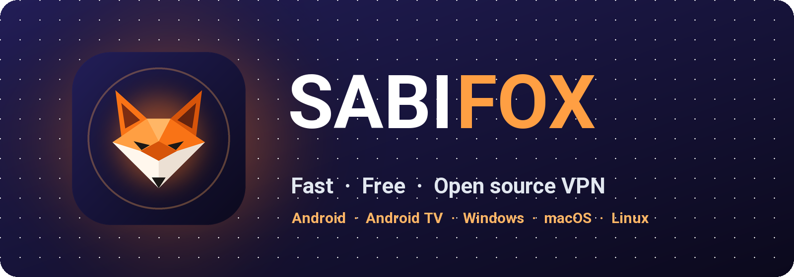

<div align="center">

[🇺🇸 English](../../README.md) &nbsp;/&nbsp; [🇮🇷 فارسی](README_fa.md) &nbsp;/&nbsp; [🇨🇳 简体中文](README_zh.md) &nbsp;/&nbsp; **🇷🇺 Русский**

</div>
<br>

<p align="center"></p>

<h2 align="center">⚠️ Неофициальный проект</h2>

<h3 align="center">SABIFOX — независимый проект. Он не создан Mozilla, не принадлежит ей, не спонсируется и не одобрен ею и никак не связан с Mozilla. См. <a href="#отказ-от-ответственности">отказ от ответственности</a>.</h3>

<div align="center">

[](https://github.com/sabi-karami/sabifox/releases)
[](https://github.com/sabi-karami/sabifox/releases/latest)
[](../../LICENSE)
[](https://github.com/sabi-karami/sabifox/stargazers)
[](https://github.com/sabi-karami/sabifox/actions)


</div>

## Что такое SABIFOX?

**SABIFOX** — бесплатный VPN с открытым исходным кодом, который работает с аккаунтом Firefox (Firefox Account). Он передаёт ваш интернет-трафик через серверы Mozilla, на инфраструктуре **Fastly**, по защищённым туннелям **HTTP/2 и HTTP/3**.

Для **Android, Windows, macOS и Linux**; полностью бесплатно, без рекламы.


## 🚀 Основные возможности

✈️ Кроссплатформенность: Android, Windows, macOS и Linux

📺 Android TV: управление с пульта

⭐ Очень простой в использовании, с понятным интерфейсом

🆓 Бесплатно: 50 ГБ в месяц на каждый аккаунт Firefox

🌐 Серверы Mozilla: выбор страны с проверкой пинга или автоматический выбор лучшего сервера

⚡ Быстрое и стабильное соединение по HTTP/2 и HTTP/3

🔀 Умная маршрутизация (Split Tunneling): выберите сайты и приложения, которые не идут через VPN

🧱 Если ваша сеть блокирует подключение: фрагментация TLS, вышестоящий прокси SOCKS5 и сервер-ретранслятор

🔒 Зашифрованный DNS (DNS over HTTPS)

🌍 15 языков, включая английский, персидский, китайский и русский

🌙 Светлая и тёмная темы

🛡 Открытый исходный код, безопасность и развитие сообществом

🔄 Автоматические обновления


## 📥 Скачать

<table>
<thead>
<tr><th>Система</th><th>Скачать</th></tr>
</thead>
<tbody>
<tr><td>Android</td><td><a href="https://github.com/sabi-karami/sabifox/releases/latest/download/SABIFOX-Android-universal.apk"></a><br><a href="https://github.com/sabi-karami/sabifox/releases/latest/download/SABIFOX-Android-arm64-v8a.apk"></a><br><a href="https://github.com/sabi-karami/sabifox/releases/latest/download/SABIFOX-Android-armeabi-v7a.apk"></a><br><a href="https://github.com/sabi-karami/sabifox/releases/latest/download/SABIFOX-Android-x86_64.apk"></a></td></tr>
<tr><td>Android TV</td><td><a href="https://github.com/sabi-karami/sabifox/releases/latest/download/SABIFOX-Android-universal.apk"></a></td></tr>
<tr><td>Windows</td><td><a href="https://github.com/sabi-karami/sabifox/releases/latest/download/SABIFOX-Windows-Setup-x64.exe"></a><br><a href="https://github.com/sabi-karami/sabifox/releases/latest/download/SABIFOX-Windows-x64.zip"></a></td></tr>
<tr><td>macOS</td><td><a href="https://github.com/sabi-karami/sabifox/releases/latest/download/SABIFOX-macOS.dmg"></a></td></tr>
<tr><td rowspan="2">Linux</td><td><a href="https://github.com/sabi-karami/sabifox/releases/latest/download/SABIFOX-Linux-amd64.tar.gz"></a><br><a href="https://github.com/sabi-karami/sabifox/releases/latest/download/SABIFOX-Linux-arm64.tar.gz"></a></td></tr>
<tr><td><a href="https://github.com/sabi-karami/sabifox/releases/latest/download/sabifox-core-linux-amd64.tar.gz"></a><br><a href="https://github.com/sabi-karami/sabifox/releases/latest/download/sabifox-core-linux-arm64.tar.gz"></a></td></tr>
</tbody>
</table>

**Какой файл скачать?**

- **Android:** если не уверены, берите **Universal** — он устанавливается на любой телефон. **ARMv8** подходит для большинства современных телефонов и весит меньше.
- **Windows:** **Setup** — обычный установщик; **Portable** работает без установки из любой папки.
- **Linux:** **App** — для Linux с рабочим столом (с графической средой); **Core** — для сервера (без графической среды, с веб-панелью).

## 💻 Установка и обновление в Linux и macOS

> Пользователям Windows и Android этот раздел не нужен: возьмите установочный файл из таблицы «Скачать» выше.

```bash
curl -fsSL https://raw.githubusercontent.com/sabi-karami/sabifox/main/install.sh | bash
```

### 🌐 Веб-панель

Для серверов Linux у SABIFOX есть **веб-панель**, которая открывается в любом браузере и умеет всё, что умеет приложение: управление аккаунтами и трафиком, выбор сервера и проверка задержки, проверка соединения, живой журнал и все настройки.


- **Адрес панели:** `http://SERVER-IP:10820/app/`, с именем пользователя и паролем. Точный адрес показывается в конце установки.
- **Прокси:** SOCKS5 и HTTP на порту `10810`, с отдельными именем пользователя и паролем.

### ⌨️ Управление из терминала

На сервере выполните `sudo sabifox`, чтобы открыть меню управления:

```text
$ sudo sabifox

  SABIFOX
  ────────────────────────────────────────────────────────────────────────────
    Service     ● running
    Autostart   on
  ────────────────────────────────────────────────────────────────────────────
   0) Exit
  ────────────────────────────────────────────────────────────────────────────
   1) Update                                   sabifox update
   2) Uninstall                                sabifox uninstall
  ────────────────────────────────────────────────────────────────────────────
   3) Set panel login                          sabifox panel
   4) View panel info                          sabifox panel-info
  ────────────────────────────────────────────────────────────────────────────
   5) Status                                   sabifox status
   6) Start                                    sabifox start
   7) Stop                                     sabifox stop
   8) Restart                                  sabifox restart
   9) Show the log                             sabifox logs
  ────────────────────────────────────────────────────────────────────────────
  10) Enable autostart                         sabifox enable
  11) Disable autostart                        sabifox disable
  ────────────────────────────────────────────────────────────────────────────
  12) Add a Firefox Account                    sabifox add-account
  13) List the accounts                        sabifox list-accounts
  ────────────────────────────────────────────────────────────────────────────
  Enter a number [0-13]:
```

## Роутеры OpenWrt

Чтобы установить на роутер OpenWrt, см. [руководство по OpenWrt](../OPENWRT.md).

## Отказ от ответственности

Это приложение — независимый неофициальный клиент, который создаёт и поддерживает его собственный разработчик. Это не продукт Mozilla: Mozilla его не создавала, не владеет им, не спонсирует и не одобряет его и не участвует в его разработке и поддержке. С вопросами и проблемами приложения обращайтесь в этот репозиторий, а не в Mozilla.

Вы входите со своим собственным аккаунтом Mozilla. Условия, лимит трафика и доступность аккаунта определяет Mozilla. Ваш пароль и токены входа остаются на вашем устройстве.

---

<p align="center"></p>
<p align="center">Сделано с ♥ — <b>Saheb Karami</b></p>
<p align="center" dir="rtl">ساخته شده با ♥ توسط <b>صاحب کرمی</b></p>
